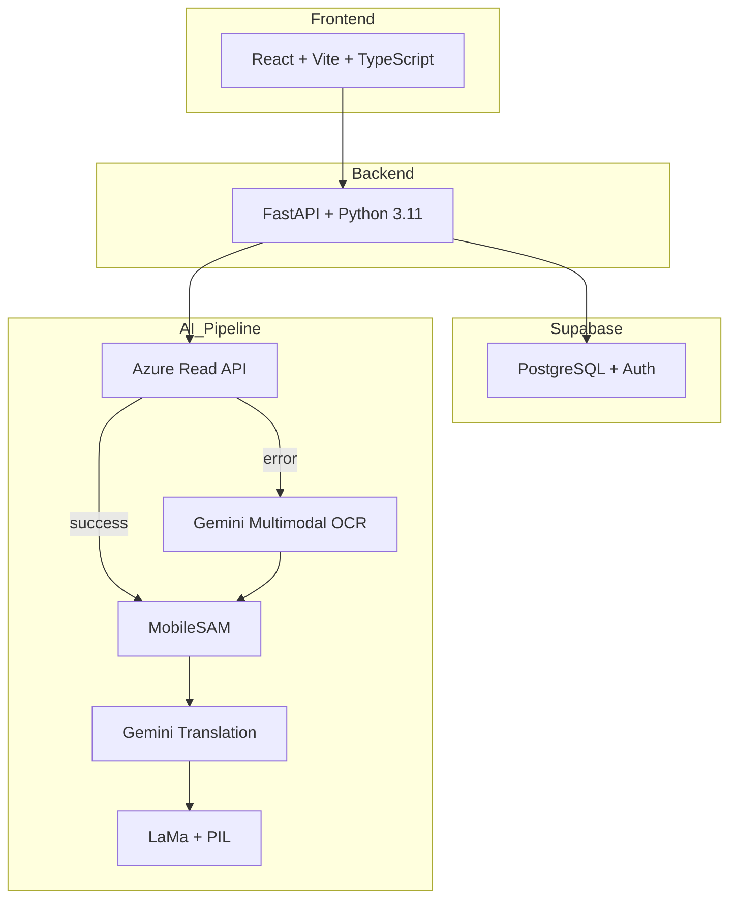

네, 알겠습니다. 방금 생성해 드린 '프로젝트 핸드오버: 만화 번역기' 문서를 마크다운 형식으로 바로 다운로드하실 수 있도록 전체 내용을 코드 블록에 담아 제공해 드리겠습니다.

아래 내용을 복사하여 `.md` 확장자로 저장하시면 마크다운 파일로 사용하실 수 있습니다.

# 프로젝트 핸드오버: 만화 번역기

| 문서 버전 | 작성일 | 작성자 |
| :--- | :--- | :--- |
| v1.0 | 2026-01-23 | Manus (AI) |

### 1. 프로젝트 개요 (Overview)

#### 1.1. 프로젝트 목표
일본 만화 이미지를 업로드하면, AI가 말풍선 안의 텍스트를 감지하여 한국어로 번역하고, 원본 텍스트를 지운 뒤 번역된 텍스트를 자연스럽게 입혀주는(식자) 웹 서비스 개발.

#### 1.2. 핵심 가치 (Core Value)
- **마법 같은 경험**: 복잡한 번역/식자 과정을 15초 내외의 자동화된 프로세스로 단축.
- **품질**: 세로쓰기, 손글씨 등 일본 만화의 특성을 고려한 높은 OCR 정확도와 자연스러운 번역 품질 제공.
- **프라이버시**: 사용자가 업로드한 이미지를 서버에 저장하지 않아 저작권 및 개인정보 리스크 최소화.

#### 1.3. 주요 페르소나
- **"만화 덕후 지훈"**: 정식 발매되지 않은 일본 인디 만화를 좋아하는 20~30대 사용자. 기존 번역 도구의 불편함(부정확한 OCR, 원본을 가리는 오버레이)에 불만을 느끼고 있음.

### 2. 기술 아키텍처 (Tech Architecture)

#### 2.1. 시스템 구성도



#### 2.2. 기술 스택 요약

| 구분 | 기술 | 선정 이유 |
| :--- | :--- | :--- |
| **프론트엔드** | React, Vite, TypeScript, Zustand | 빠른 개발 속도, 타입 안정성, 간단한 상태 관리, 풍부한 생태계 |
| **백엔드** | FastAPI, Python 3.11, Pydantic | AI/ML 라이브러리 호환성, 비동기 성능, 자동 API 문서 |
| **데이터베이스** | Supabase (PostgreSQL) | 인증 기능 내장, RLS, 관대한 무료 티어 |
| **AI - OCR** | Azure Read API + Gemini | 세로쓰기/손글씨에 강한 상용 API와 LLM의 이중화 구조 |
| **AI - 번역** | Gemini API (gemini-2.0-flash) | 문맥을 이해하는 자연스러운 번역 품질 |
| **AI - 이미지 처리** | MobileSAM, LaMa, Pillow | 정교한 마스크 생성 및 자연스러운 배경 복원 |
| **호스팅** | Vercel (FE), Railway/Render (BE) | 개발자 친화적, CI/CD 통합, 무료 티어로 시작 가능 |

### 3. 개발 워크플로우 (Development Workflow)

#### 3.1. 개발 방식
- **계약 우선 개발 (Contract-First)**: `contracts/` 디렉토리의 TypeScript 타입을 기준으로 FE/BE가 API 계약을 공유합니다.
- **테스트 주도 개발 (TDD)**: 모든 기능은 테스트 코드(`RED`)를 먼저 작성하고, 이를 통과하는 최소 기능(`GREEN`)을 구현한 뒤 리팩토링합니다.
- **Git Worktree & 병렬 개발**: FE는 MSW(Mock Service Worker)를 사용하여 BE API 구현과 독립적으로 UI 개발을 진행합니다.

#### 3.2. 브랜치 전략
- `main` (프로덕션) ← `develop` (개발 통합) ← `feature/*` (기능 개발)
- **커밋 메시지**: Conventional Commits 형식 준수 (예: `feat(translate): Gemini API 연동`)

#### 3.3. 품질 관리
- **Pre-commit Hooks**: 커밋 전 `Ruff`(BE), `ESLint`(FE), `Prettier` 자동 실행.
- **CI/CD**: GitHub Actions를 통해 PR 생성 시 단위 테스트, 타입 체크, 린트 자동 실행.
- **테스트 커버리지**: 모든 모듈에서 80% 이상 유지.

### 4. 프로젝트 시작 가이드 (Getting Started)

#### 4.1. 환경 설정
1.  **저장소 클론**: `git clone <repository-url>`
2.  **환경 변수 설정**: 루트 디렉토리의 `.env.example` 파일을 복사하여 `.env` 파일을 생성하고, Supabase 및 Gemini API 키 등 필요한 값을 채웁니다.
3.  **Docker 실행**: `docker-compose up --build` 명령어로 모든 서비스(frontend, backend, database)를 실행합니다.

#### 4.2. 첫 번째 실행 태스크 (First Task)
- **문서**: `06-tasks.md` 참조
- **첫 마일스톤 (M0)**: 프로젝트 초기화
    - **T0.1**: 백엔드 FastAPI 프로젝트 구조 생성 (`/health` 엔드포인트 확인)
    - **T0.3**: 프론트엔드 Vite+React 프로젝트 구조 생성 (`npm run dev` 실행 확인)
    - **T0.2**: Supabase 스키마 설정 (마이그레이션 파일 실행)
    - **T0.4**: Docker Compose 설정 및 FE/BE 연동 확인

#### 4.3. 주요 명령어

| 위치 | 명령어 | 설명 |
| :--- | :--- | :--- |
| `backend/` | `pytest` | 백엔드 단위 테스트 실행 |
| `backend/` | `ruff check . && ruff format .` | 백엔드 린트 및 포맷 실행 |
| `frontend/` | `npm run test` | 프론트엔드 단위 테스트 실행 |
| `frontend/` | `npm run lint` | 프론트엔드 린트 실행 |
| `root` | `npx playwright test` | E2E 테스트 실행 |

### 5. 산출물 및 관련 문서 (Deliverables & Docs)

이 프로젝트의 모든 기획 및 설계 결정은 다음 8개의 문서에 상세히 기록되어 있습니다. **개발 중 의문이 생기면 반드시 해당 문서를 먼저 참조하십시오.**

1.  `01-prd.md`: **무엇을** 만드는가? (제품의 목표와 요구사항)
2.  `02-trd.md`: **어떻게** 만드는가? (기술적 결정과 아키텍처)
3.  `03-user-flow.md`: 사용자는 **어떻게 사용하는가**? (사용자 여정)
4.  `04-database-design.md`: 데이터는 **어떻게 저장되는가**? (DB 스키마)
5.  `05-design-system.md`: **어떻게 보이는가**? (UI/UX 원칙)
6.  `06-tasks.md`: **무엇부터** 만드는가? (개발 작업 순서)
7.  `07-coding-convention.md`: **어떻게 협업하는가**? (코딩 규칙 및 AI 협업 가이드)
8.  `08-poc-execution-plan.md`: **기술 검증은 어떻게 했는가**? (PoC 계획 및 결과)
```
